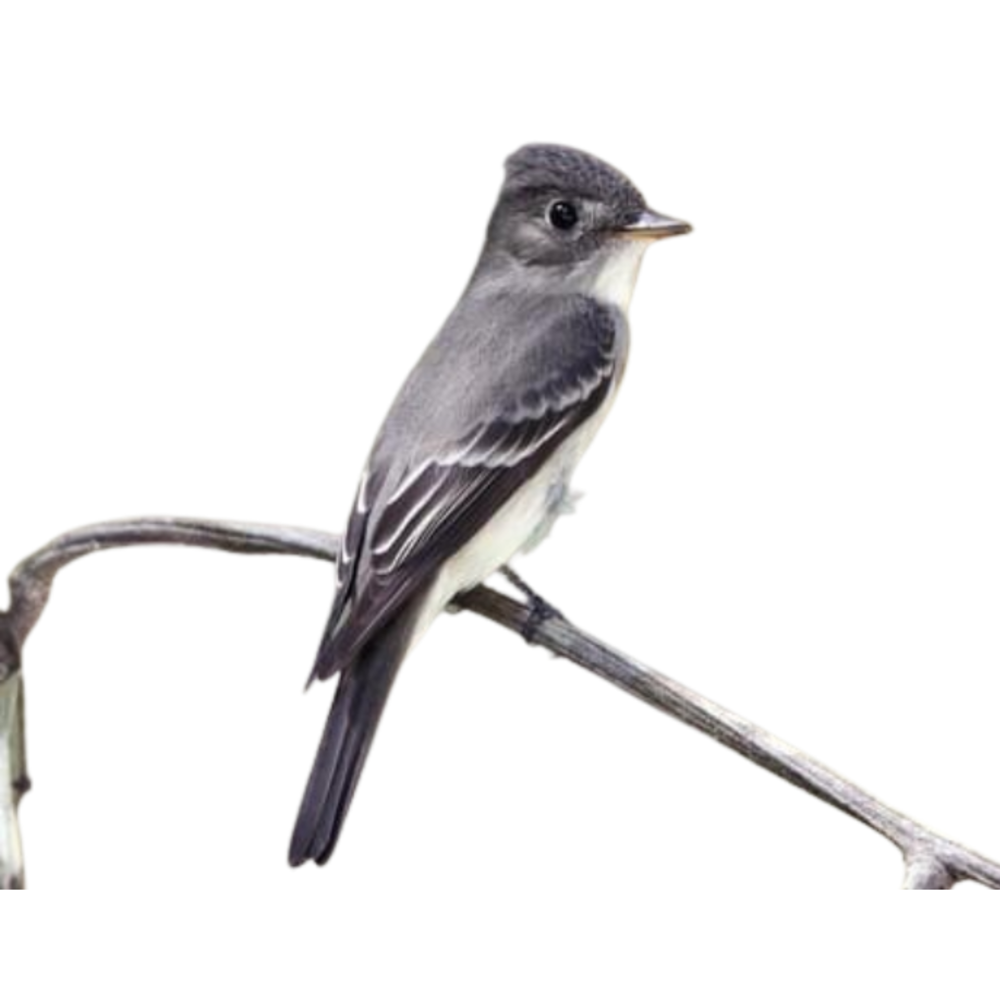

# Pewee



_Just write. Just publish._

Pewee is a minimal, self-hosted, open-source blog with a built-in CMS dashboard, built with Next.js and MongoDB. Clone it, add your name and logo, connect a database, and deploy it as your own blog.

- **Reading experience:** a quiet, typographic dark theme, a floating table of contents, reading time, and share links.
- **CMS dashboard:** a rich-text (Tiptap) editor with live preview, plus create, edit, archive and delete.
- **SEO:** per-post metadata, Open Graph and Twitter cards, JSON-LD, a `sitemap.xml`, `robots.txt` and an RSS feed.
- **Fast:** pages are statically generated and refresh as soon as you publish.
- **Yours:** all branding lives in one file.

---

## Contents

- [Quick start](#quick-start)
- [MongoDB setup](#mongodb-setup)
- [Environment variables](#environment-variables)
- [Rebranding](#rebranding)
- [Using the CMS dashboard](#using-the-cms-dashboard)
- [Deployment](#deployment)
- [Project structure](#project-structure)
- [API reference](#api-reference)
- [Scripts](#scripts)

---

## Quick start

Requirements: **Node.js 20.9+** and a MongoDB database (see [MongoDB setup](#mongodb-setup)).

```bash
git clone https://github.com/anshumancodes/Pewee.git my-blog
cd my-blog
npm install

cp .env.example .env        # then fill in MONGO_DB_URI and JWT_SECRET
npm run create-admin        # create your CMS login
npm run dev
```

- Blog: http://localhost:3000
- CMS sign-in: http://localhost:3000/auth (redirects to `/dashboard` once you're signed in)

---

## MongoDB setup

Pewee stores posts and admin accounts in MongoDB through Mongoose. You don't need to create collections or run migrations; they're created on first use.

### Option A: MongoDB Atlas (hosted, free tier available)

1. Create a free cluster at <https://www.mongodb.com/atlas>.
2. Under **Database Access**, add a database user with a password.
3. Under **Network Access**, allow your IP for local development. For serverless hosts like Vercel, allow `0.0.0.0/0`.
4. Click **Connect → Drivers** and copy the connection string:
   ```
   MONGO_DB_URI=mongodb+srv://<user>:<password>@<cluster>.mongodb.net/
   DB_NAME=pewee
   ```

### Option B: local MongoDB

```bash
docker run -d --name pewee-mongo -p 27017:27017 mongo:7
```

```
MONGO_DB_URI=mongodb://localhost:27017
DB_NAME=pewee
```

### Data model

| Collection | Purpose |
| ---------- | ------- |
| `blogs`    | Posts: `title`, `slug`, `content` (HTML), `author`, `coverImg`, `archived`, `series`, `createdBy`, `deletedBy`, plus timestamps. Deleting a post is a soft delete that sets `deletedBy`. |
| `users`    | CMS accounts: `Name`, `username`, `email`, `password` (bcrypt hash), `role` (`ADMIN` / `USER`). Only `ADMIN` users can sign in to the dashboard. |
| `series`   | Optional grouping of posts into a series (schema is ready for future use). |

---

## Environment variables

All variables are documented in [`.env.example`](.env.example).

| Variable              | Required          | Description |
| --------------------- | ----------------- | ----------- |
| `MONGO_DB_URI`        | ✅                | MongoDB connection string. |
| `DB_NAME`             | recommended       | Database name. Optional if the URI already includes one. |
| `JWT_SECRET`          | ✅ in production  | Secret that signs CMS sessions. Generate one with `openssl rand -base64 32`. |
| `NEXT_PUBLIC_APP_URL` | ✅ in production  | Your public URL, with no trailing slash (e.g. `https://blog.example.com`). Canonical URLs, Open Graph, the sitemap and RSS all use it. |
| `NEXT_PUBLIC_GA_ID`   | optional          | Google Analytics ID (`G-…`). Analytics is off when this is empty. |

> `NEXT_PUBLIC_*` values are baked in at build time, so rebuild after changing them.

---

## Rebranding

**Everything that identifies the site lives in [`src/site.config.ts`](src/site.config.ts).** Edit that one file:

```ts
export const siteConfig = {
  name: "pewee",                         // navbar, footer, dashboard, <title> suffix
  tagline: "Just write. Just publish.",  // under the name in the footer
  title: "pewee — a minimal blog",       // home page <title>
  description: "…",                      // default meta description and RSS description
  logo: "/Pewee..png",                   // navbar logo (file in /public)
  ogImage: "/Pewee..png",                // default social share image
  icon: "/Pewee..png",                   // favicon
  author: { name: "pewee", url: siteUrl },
  twitterHandle: "",                     // "@you": adds twitter:site / twitter:creator
  socialLinks: [{ label: "GitHub", href: "https://github.com/you" }],
  discussLink: null,                     // e.g. { label: "X", href: "https://x.com/you" }
  announcement: null,                    // optional banner above the navbar
  credit: { label: "Pewee", href: "…" }, // "Built with Pewee" in the footer, or null
  // …
};
```

To replace the logo, drop your image into `public/` and point `logo`, `icon` and `ogImage` at it. For best results, use a 1200×630 image for `ogImage`.

The visual theme (colors and fonts) is defined with CSS variables at the top of [`src/app/globals.css`](src/app/globals.css).

---

## Using the CMS dashboard

### 1. Create an admin account

```bash
npm run create-admin
# or non-interactively:
ADMIN_PASSWORD='a-strong-password' npm run create-admin -- --email you@example.com --name "Your Name" --username yourname
```

If you run the command again with an existing email, Pewee promotes that user to admin and resets their password. Use this to recover a lost password.

### 2. Sign in

Go to **`/auth`** and sign in. Sessions last 8 hours and use an HTTP-only cookie.

### 3. Write and manage posts

| Page | What you can do |
| ---- | --------------- |
| `/dashboard` | Overview: total, published, archived and deleted counts, plus recent posts. |
| `/dashboard/manage-blog` | Create a post (the slug is generated from the title), edit, preview, archive or unarchive, and delete. |

- **Publish:** a new post goes live as soon as you save it.
- **Archive:** hides a post from the public site, sitemap and feed while keeping it in the CMS.
- **Delete:** soft-deletes the post. It disappears from the CMS and the site, but the document stays in MongoDB.
- Slugs must be 15–100 characters and content at least 100 characters.

Every create, edit, archive and delete immediately refreshes the home page, `/blog`, the post page, `sitemap.xml` and `rss.xml`.

---

## Deployment

Pewee is a standard Next.js app and runs anywhere that supports Node.js.

### Vercel

1. Push your fork to GitHub and import it in Vercel.
2. Add the environment variables: `MONGO_DB_URI`, `DB_NAME`, `JWT_SECRET`, `NEXT_PUBLIC_APP_URL` and, optionally, `NEXT_PUBLIC_GA_ID`.
3. In MongoDB Atlas **Network Access**, allow `0.0.0.0/0`. Vercel uses dynamic IPs, and the build itself reads from the database to pre-render pages.
4. Deploy, then run `npm run create-admin` locally against the production database to create your login.

### Any Node.js host (VPS, Railway, Render, Fly.io, …)

```bash
npm ci
npm run build
npm start          # serves on PORT (default 3000)
```

Set the same environment variables on the host. If the build environment can't reach MongoDB, the build still succeeds. Pages render empty at first and fill in on the next request after the hourly revalidation, or as soon as you publish.

### After deploying

- Visit `/sitemap.xml`, `/robots.txt` and `/rss.xml` to confirm your URL is correct.
- Submit the sitemap in Google Search Console.

---

## Project structure

```
src/
├── site.config.ts            ← branding and SEO defaults (edit me)
├── proxy.ts                  ← protects /dashboard (Next.js middleware)
├── app/
│   ├── page.tsx              ← home: post list
│   ├── blog/page.tsx         ← /blog: post list
│   ├── blog/[slug]/page.tsx  ← article page (metadata, JSON-LD, TOC)
│   ├── auth/page.tsx         ← CMS sign-in
│   ├── dashboard/            ← CMS (overview, manage posts)
│   ├── api/admin/            ← login (POST) / logout (DELETE)
│   ├── api/blog/             ← post CRUD API
│   ├── sitemap.ts, robots.ts ← SEO
│   └── rss.xml/route.ts      ← RSS 2.0 feed
├── components/               ← navbar, footer, blog cards, TOC, editor
├── db/dbconnect.ts           ← cached Mongoose connection
├── lib/
│   ├── blog.ts               ← server-side post queries and helpers
│   ├── auth.ts               ← JWT session helpers
│   └── revalidate.ts         ← cache refresh after CMS changes
└── schemas/                  ← Mongoose models (Blog, User, Series)
scripts/create-admin.mjs      ← create or reset an admin account
```

---

## API reference

All responses use the shape `{ statuscode, data, message }`. Write endpoints need an admin session cookie, which you get by signing in at `/auth`.

| Method | Route | Auth | Description |
| ------ | ----- | ---- | ----------- |
| `POST`   | `/api/admin`               | –     | Sign in with `{ email, password }`. |
| `DELETE` | `/api/admin`               | –     | Sign out. |
| `GET`    | `/api/blog/fetch/all`      | –     | Published posts. Supports `?page=&limit=` (max 50). Admins can add `includeArchived=true`. |
| `GET`    | `/api/blog/fetch/:slug`    | –     | A single published post. Admins can also fetch archived posts. |
| `POST`   | `/api/blog/create`         | admin | Create a post: `{ title, slug, author, content, coverImg? }`. |
| `PATCH`  | `/api/blog/update`         | admin | Update a post: `{ slug, title?, content?, author?, coverImg?, archived?, newSlug? }`. |
| `DELETE` | `/api/blog/delete`         | admin | Soft-delete a post: `{ slug }`. |

---

## Scripts

| Command | Description |
| ------- | ----------- |
| `npm run dev`          | Start the dev server. |
| `npm run build`        | Create a production build. |
| `npm start`            | Serve the production build. |
| `npm run lint`         | Run ESLint. |
| `npm run typecheck`    | Run the TypeScript type check. |
| `npm run create-admin` | Create or reset a CMS admin account. |

---

## Roadmap

- Newsletter: posts flow through one publish path (`src/lib/revalidate.ts` is called on every create and update), so an "on publish" email hook can go there later without touching the blog or the CMS.
